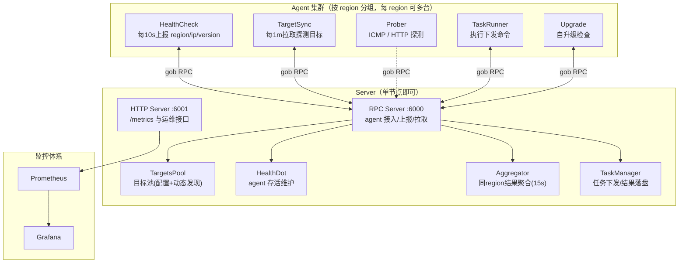
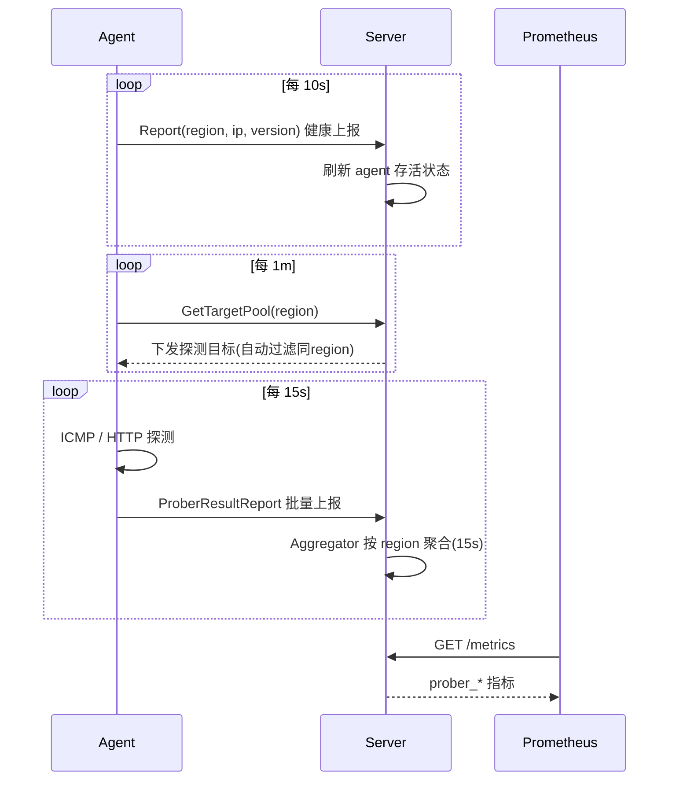

# ProberMesh — 分布式网格化拨测框架

ProberMesh 是一款 server/agent 二合一的分布式拨测框架，让各 region/zone 的节点两两探测，自动组成一张 **ICMP Mesh 网格**，同时支持 HTTP 多点拨测。同 region 部署多台 agent 互为冗余，结果聚合后更加稳定可靠。

## 核心特性

- **二合一部署**：单二进制同时支持 server / agent 两种模式
- **ICMP 自动发现**：agent 一键部署即自动加入网格，无需 consul 等额外组件
- **内网/公网双模式**：自动发现支持内网 IP 与公网出口 IP 两种维度
- **容错聚合**：同 region 多 agent 结果聚合，规避单点网络抖动造成的告警噪音
- **双协议支持**：ICMP 网格 + HTTP 多点拨测可共存，HTTP 配置对齐 blackbox_exporter
- **分阶段耗时**：HTTP 支持 resolve/connect/tls/processing/transfer 五阶段；ICMP 支持 resolve/rtt/min/max 及丢包率、抖动标准差
- **Prometheus 原生指标**：server 暴露 OpenMetrics 供 Prometheus 直接抓取
- **运维能力**：agent 自升级、任务下发（网络调试利器）、Grafana 面板即导即用

## 架构总览



## 数据链路



## 快速开始

### 场景一：公网 ICMP 网格化拨测

```bash
# server 端（dynamic 模式自动发现）
./probermesh -mode server \
  -server.icmp.discovery=dynamic \          # 默认即 dynamic
  -server.rpc.listen.addr=1.1.1.1:6000 \
  -server.http.listen.addr=1.1.1.1:6001

# agent 端（各 region 部署，上报公网出口 IP）
./probermesh -mode agent \
  -agent.region=ali-cn-shanghai \
  -agent.icmp.network-type=public \         # 公网模式
  -agent.rpc.report.addr=1.1.1.1:6000
```

### 场景二：内网 ICMP 网格化拨测

```bash
# server 端与场景一相同
./probermesh -mode server -server.icmp.discovery=dynamic

# agent 端仅将 network-type 改为 intranet（默认值）
./probermesh -mode agent \
  -agent.region=ali-cn-shanghai \
  -agent.rpc.report.addr=1.1.1.1:6000
```

### 场景三：静态配置拨测（HTTP / 指定 ICMP 目标）

```bash
# server 端 static 模式，必须指定配置文件
./probermesh -mode server \
  -server.icmp.discovery=static \
  -server.probe.file=./probermesh.yaml

# agent 端无需 region 限定（按 server 下发配置拨测）
./probermesh -mode agent -agent.rpc.report.addr=1.1.1.1:6000
```

> ICMP 默认不拨测自身 region，如需同 region 互测，server 加 `-server.probe.self`；
> ICMP 探测需要 agent 进程具备 root 权限。

## 配置参考

### 启动参数

| 分类 | 参数 | 默认值 | 说明 |
|------|------|--------|------|
| 通用 | `-mode` | `server` | 服务模式 agent/server |
| 通用 | `-log.dir` | `/logs/` | 日志目录（自动按天切割，保留7天） |
| 通用 | `-log.level` | `3` | 日志级别 0-6（Panic..Trace） |
| server | `-server.rpc.listen.addr` | `localhost:6000` | RPC 监听地址 |
| server | `-server.http.listen.addr` | `localhost:6001` | HTTP/指标监听地址 |
| server | `-server.probe.file` | 空 | 探测配置文件路径（static 模式必填） |
| server | `-server.icmp.discovery` | `dynamic` | icmp 目标发现模式：static=按配置 / dynamic=按 agent 上报自动发现（会覆盖同 region 配置的 icmp 目标） |
| server | `-server.aggregation.interval` | `15s` | 结果聚合周期 |
| server | `-server.series.cache.ratio` | `5` | 指标缓存时长重置倍率（过期 series 自动清理） |
| server | `-server.task` | `false` | 开启任务下发功能 |
| server | `-server.task.meta.dir` | `./task_meta/` | 任务结果落盘目录 |
| server | `-server.probe.self` | `false` | 允许 agent 拨测自身 region |
| agent | `-agent.rpc.report.addr` | `localhost:6000` | server RPC 地址 |
| agent | `-agent.region` | 自动获取 | 所属 region，优先级见下方说明 |
| agent | `-agent.probe.interval` | `15s` | 探测周期 |
| agent | `-agent.sync.interval` | `1m` | 拉取探测目标周期 |
| agent | `-agent.icmp.network-type` | `intranet` | 上报 IP 类型：intranet=内网 / public=公网 |
| agent | `-agent.upgrade` | `false` | 开启自升级 |
| agent | `-agent.upgrade.interval` | `1m` | 升级检查周期 |

**agent region 获取优先级**：`-agent.region` 参数 > 环境变量 `PROBER_REGION` > 自动探测云厂商 metadata（阿里云 / 腾讯云 / 谷歌云 / 华为云 / 火山引擎 / AWS） > 默认 `cn-shanghai`

### 探测配置文件（`-server.probe.file`）

```yaml
prober_configs:
  # HTTP 多点拨测（配置段对齐 blackbox_exporter）
  - prober_type: http
    region: project-01
    http:
      valid_status_codes: [200, 201]
      method: GET
      headers:
        Accept: text/html,application/xhtml+xml
      fail_if_body_matches_regexp: text.*
    targets:
      - http://www.baidu.com
      - www.taobao.com

  # ICMP 拨测（可选配置包数/包大小/发包间隔）
  - prober_type: icmp
    region: cn-hangzhou
    icmp:
      packet_count: 64        # 包数
      payload_size: 64        # 包大小（字节）
      interval: 15ms          # 发包间隔
    targets:
      - 180.101.49.12
      - 8.8.8.8
```

## 指标一览

| 指标 | 类型 | 说明 |
|------|------|------|
| `prober_icmp_failed` | gauge | icmp 当前失败数 |
| `prober_icmp_duration_seconds` | gauge | icmp 分阶段耗时（phase: resolve/rtt/min/max） |
| `prober_icmp_packet_loss_rate` | gauge | icmp 丢包率 |
| `prober_icmp_jitter_stddev_seconds` | gauge | icmp 抖动标准差 |
| `prober_icmp_duration_seconds_total` | histogram | icmp 耗时分布 |
| `prober_http_failed` | gauge | http 当前失败数（含失败原因 label） |
| `prober_http_duration_seconds` | gauge | http 分阶段耗时（phase: resolve/connect/tls/processing/transfer） |
| `prober_http_ssl_earliest_cert_expiry` | gauge | https 证书最早过期时间 |
| `prober_http_status_code` | gauge | http 响应码 |
| `prober_agent_is_alive` | gauge | agent 存活状态 |
| `prober_server_receive_points` | counter | server 接收上报点数 |
| `prober_server_task_enabled` | gauge | 任务下发功能开关 |
| `prober_server_probe_self_enabled` | gauge | 同 region 拨测开关 |

Prometheus 抓取配置：

```yaml
scrape_configs:
  - job_name: "probermesh"
    scrape_interval: 15s
    static_configs:
      - targets: ["<server-ip>:6001"]
```

Grafana 面板可直接导入 `build/grafana/probermesh-icmp.json`（ICMP 网格）与 `build/grafana/probermesh-http.json`（HTTP 拨测）。

## 高级功能

### 任务下发（网络调试）

在拨测异常时，可向目标 region 的 agent 下发 `mtr` 等排查命令：

```bash
# server 需开启 -server.task；管理机 POST 下发
curl -X POST http://<server-ip>:6001/-/task -d '{
    "region": "欧洲-美国-*",
    "expr": "=~",
    "cmd": "mtr -r www.baidu.com -c 20 -i 0.1"
}'
```

- `region`：匹配 agent 的 region，支持正则
- `expr`：`=` 匹配 / `!=` 不匹配 / `=~` 正则匹配 / `!~` 正则不匹配
- 执行结果由 agent 上报并落盘到 server 的 `-server.task.meta.dir` 目录

### Agent 自升级

```bash
# server 下发升级指令
curl -X POST http://<server-ip>:6001/-/upgrade -d '{
    "downloadURL": "http://172.18.12.38:9999/probermesh",
    "md5Check": "0a85983226d91029bcf5701f94d18753",
    "version": "0.0.9",
    "force": false
}'
```

前提：agent 开启 `-agent.upgrade`，且由守护进程托管（supervisord / systemd）。`force=false` 时按版本号正常升级；`force=true` 时强制升级且只执行一次，防止失败无限重启。

## 部署与运维

| 方式 | 说明 |
|------|------|
| 源码构建 | `make build`（linux amd64，含 upx 压缩）或 `cd cmd/probermesh && go build -o probermesh .` |
| 容器 | `docker build -t probermesh .`（`Dockerfile`） |
| K8s | `build/kubernetes/` 提供 server Deployment 与 agent DaemonSet |
| systemd | `build/service/` 提供 server/agent 单元文件 |
| agent 批量部署 | `sh script/probermesh_agent_deploy.sh <region>`（基于 supervisor 托管，按需调整脚本内启动参数） |

> 场景选择小结：内网/公网互通环境下做 ICMP 网格 → dynamic 模式 + 对应 `network-type`；
> 自定义拨测对象（HTTP / 指定 IP）→ static 模式 + 配置文件，所有 agent 按 server 下发配置探测。
